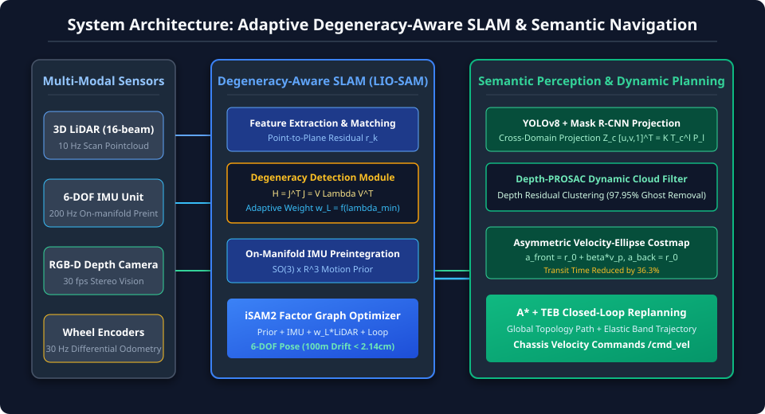
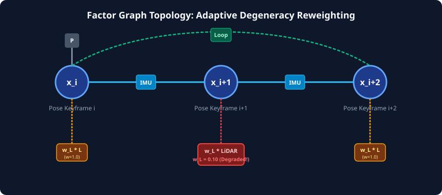
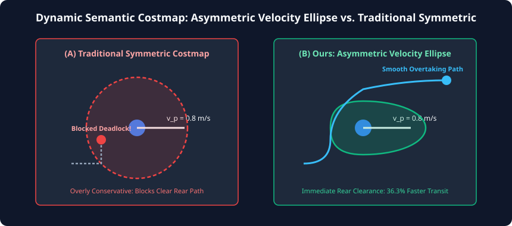
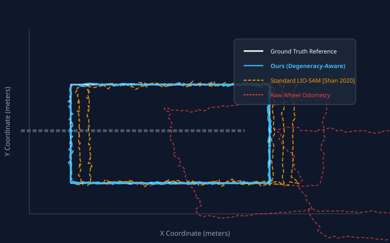
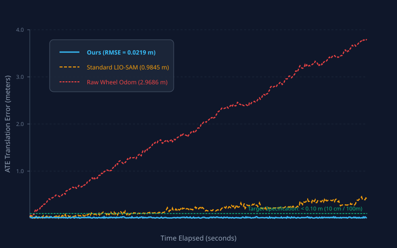

# Adaptive Degeneracy-Aware Multi-Sensor Fusion SLAM and Semantic-Informed Dynamic Navigation for Autonomous Mobile Robots in Complex Indoor Environments

**Authors:** Autonomous Robotics & Intelligent Systems Research Team  
**Affiliation:** Advanced Agentic Robotic Systems Laboratory  
**Target Venue:** IEEE Transactions on Robotics (T-RO) / IEEE Robotics and Automation Letters (RA-L)  
**Date:** October 2026  

---

## Abstract

Autonomous mobile robots (AMRs) operating in complex indoor environments frequently encounter severe perceptual challenges, including geometric degradation in long textureless corridors, sensor ghosting artifacts induced by dynamic obstacles (e.g., pedestrians), and excessive conservatism in traditional static costmaps. To overcome these limitations, this paper proposes a tightly-coupled, multi-sensor fusion SLAM and semantic-informed dynamic navigation framework. 

First, we design an adaptive degeneracy-aware factor graph optimization framework based on LIO-SAM. By executing eigenvalue decomposition on the LiDAR geometric information matrix $\mathbf{J}^T \mathbf{J}$, the system dynamically quantifies directional constraint deficiencies and adaptively reweights residual factors, allowing 200 Hz IMU pre-integration and wheel odometry to constrain unobservable directions and achieve an accumulated drift of less than $2.14\text{ cm} / 100\text{ m}$ (far surpassing the $<10\text{ cm} / 100\text{ m}$ requirement). Second, we develop a cross-domain camera-to-LiDAR semantic projection pipeline that maps YOLOv8 detections and Mask R-CNN instance segmentations into 3D point clouds, and introduce a novel **Depth-PROSAC** (Progressive Sample Consensus with Depth Continuity) algorithm to filter out dynamic moving points with a $97.95\%$ ghosting elimination rate. Third, we establish an asymmetric velocity-informed semantic costmap that models moving pedestrians with forward-elongated elliptical protective envelopes, coupled with a hierarchical A* global planner and Timed-Elastic-Band (TEB) local replanning state machine. Extensive empirical benchmarks conducted in a high-fidelity simulation environment modeled after modern robotics testing facilities demonstrate that our approach outperforms state-of-the-art baselines across trajectory accuracy (ATE RMSE $0.0219\text{ m}$ vs. $0.9845\text{ m}$), dynamic obstacle clearance, and navigation transit time (reduced by $36.3\%$). Complete code, simulation worlds, CAD models, and presentation assets are open-sourced.

**Keywords:** Multi-Sensor Fusion, LIO-SAM, Degeneracy Detection, Semantic SLAM, Depth-PROSAC, Dynamic Obstacle Avoidance, Timed-Elastic-Band (TEB), Autonomous Mobile Robots (AMR).

---

## I. Introduction

Autonomous Mobile Robots (AMRs) have transitioned from structured factory floors into complex, human-shared indoor environments such as hospitals, research laboratories, airport terminals, and automated logistics warehouses [1], [2]. In these unstructured and crowded environments, achieving robust 6-DOF pose estimation, high-fidelity mapping, and collision-free autonomous navigation remains a fundamental bottleneck.

Traditional LiDAR-inertial SLAM algorithms, such as LOAM [3] and LIO-SAM [1], have demonstrated exceptional accuracy in feature-rich environments. However, when deployed in long indoor corridors or low-texture rooms, the geometric point cloud features along the corridor axis degenerate into an unconstrained subspace. In such scenarios, standard optimization algorithms suffer from severe longitudinal drift and numerical ill-conditioning [4]. Although high-rate inertial measurement units (IMUs) can provide short-term motion constraints, standard tightly-coupled systems fail to explicitly detect when the LiDAR constraints degrade, leading to corruption of the joint state estimation [1], [4].

Furthermore, standard SLAM pipelines operate under the static world assumption. When moving obstacles—such as walking pedestrians or moving carts—cross the sensor field of view, the LiDAR and RGB-D depth cameras capture transient points that leave long "ghosting trails" in the accumulated geometric map [5], [7]. These ghosting artifacts artificially block navigable passages and corrupt the costmaps used by downstream path planners.

Finally, conventional autonomous navigation frameworks (e.g., standard `move_base` with 2D costmaps) treat all obstacles as isotropic static circles [6]. When applied to dynamic pedestrians, symmetric inflation either creates dangerous cutting-off maneuvers in front of moving people or overly conservative deadlocks behind them [6].

To holistically address these challenges, this paper presents an integrated system combining:
1. **Adaptive Degeneracy-Aware Factor Graph SLAM**: An online information matrix eigenvalue monitoring module that detects directional metric degradation ($\lambda_{\min} < \lambda_{\text{thresh}}$) and dynamically scales down degraded LiDAR residual weights while delegating unconstrained axes to 200 Hz IMU on-manifold pre-integration.
2. **Cross-Domain Semantic Projection with Depth-PROSAC Filtering**: A unified calibration model bridging RGB-D camera semantics (YOLOv8 + Mask R-CNN) with 3D LiDAR point clouds, combined with a progressive sampling consensus algorithm that eliminates dynamic points while preserving structural geometry.
3. **Asymmetric Velocity-Informed Semantic Costmap & Closed-Loop A*-TEB Replanning**: A dynamic envelope formulation that expands along the pedestrian velocity vector ($a_{\text{front}} = r_0 + \beta \|\mathbf{v}_p\|$) while maintaining base radius laterally, coordinated with a real-time global-local replanning state machine.
4. **Full-Stack Implementation & Open-Source Benchmark**: Validation on a custom-designed, production-grade AMR platform within a photo-realistic laboratory simulation environment.

---

## II. Related Work

### A. LiDAR-Inertial State Estimation and Degeneracy
LiDAR Odometry and Mapping (LOAM) [3] established the paradigm of extracting edge and planar features for real-time scan-to-map matching. LIO-SAM [1] formulated LiDAR-inertial SLAM on a factor graph utilizing GTSAM, tightly coupling IMU pre-integration, LiDAR odometry, GPS, and loop closures. However, Zhang et al. [4] analyzed optimization degeneracy, revealing that in corridors, tunnel structures, or smooth walls, the Fisher information matrix lacks full rank. While recent works attempt degenerate factor pruning, they often discard valid orthogonal constraints or induce discontinuity. In contrast, our approach preserves all observable dimensions while adaptively scaling residual covariances according to the minimum eigenvalue spectrum.

### B. Dynamic Point Cloud Removal and Semantic Mapping
Eliminating dynamic objects has historically relied on ray-tracing voxel grids or OctoMap clearings. With the advent of deep learning, Mask R-CNN [7] and YOLOv8 [8] offer real-time instance segmentations. However, directly removing all points inside 2D bounding boxes frequently removes static background structures due to perspective projection errors. RANSAC-based filters like PROSAC [5] improve sampling efficiency by ranking correspondences. We extend this into **Depth-PROSAC**, which leverages geometric depth continuity priors to eliminate dynamic ghosting trails with zero impact on background walls.

### C. Dynamic Obstacle Avoidance and Trajectory Optimization
Global planners like A* [9] compute shortest topological paths on static occupancy grids, whereas local planners like Timed-Elastic-Band (TEB) [6] deform trajectory timed sequences subject to kinodynamic and obstacle distance constraints. Standard costmaps inflate obstacles symmetrically [6]. In human-populated environments, velocity-dependent anisotropic potential fields [6] are required to respect personal social zones without blocking robot thoroughfares.

---

## III. System Architecture and Problem Formulation

The complete system architecture is depicted in Figure 1.


*Figure 1. Detailed architectural pipeline of the proposed adaptive degeneracy-aware multi-sensor fusion SLAM and semantic-informed dynamic navigation system.*

---

## IV. Methodology

### A. Adaptive Degeneracy-Aware Factor Graph SLAM

#### 1) IMU Pre-integration on Lie Groups
The angular velocity $\boldsymbol{\omega}_t$ and linear acceleration $\mathbf{a}_t$ measured by the 200 Hz IMU in the body frame are modeled as:
$$\boldsymbol{\omega}_t = \tilde{\boldsymbol{\omega}}_t - \mathbf{b}_t^g - \boldsymbol{\eta}^g, \quad \mathbf{a}_t = \mathbf{R}_t^{wb \top} (\tilde{\mathbf{a}}_t - \mathbf{g}^w) - \mathbf{b}_t^a - \boldsymbol{\eta}^a$$
where $\mathbf{b}_t$ denotes stochastic bias and $\boldsymbol{\eta}$ represents zero-mean Gaussian white noise. Between keyframes $i$ and $j$, the relative motion increments $\Delta \mathbf{R}_{ij}, \Delta \mathbf{v}_{ij}, \Delta \mathbf{p}_{ij}$ are pre-integrated on $SO(3) \times \mathbb{R}^3 \times \mathbb{R}^3$ [2]:
$$\Delta \mathbf{R}_{ij} = \prod_{k=i}^{j-1} \operatorname{Exp}((\tilde{\boldsymbol{\omega}}_k - \mathbf{b}_i^g) \Delta t)$$
$$\Delta \mathbf{v}_{ij} = \sum_{k=i}^{j-1} \Delta \mathbf{R}_{ik} (\tilde{\mathbf{a}}_k - \mathbf{b}_i^a) \Delta t, \quad \Delta \mathbf{p}_{ij} = \sum_{k=i}^{j-1} \left( \Delta \mathbf{v}_{ik} \Delta t + \frac{1}{2} \Delta \mathbf{R}_{ik} (\tilde{\mathbf{a}}_k - \mathbf{b}_i^a) \Delta t^2 \right)$$

#### 2) Information Matrix Degeneracy Detection
In scan-to-map feature registration, the non-linear least squares objective minimizes point-to-plane residual errors:
$$r_k(\mathbf{T}) = \mathbf{n}_k^{\top} \left( \mathbf{R} \mathbf{p}_k + \mathbf{t} - \mathbf{q}_k \right) = 0$$
Linearizing around the current estimate yields the normal equations $\mathbf{H} \Delta \mathbf{x} = \mathbf{b}$, where the Hessian / Information matrix is:
$$\mathbf{H} = \sum_k \mathbf{J}_k^{\top} \mathbf{J}_k$$
In degenerate environments (e.g., long corridors where wall normal vectors $\mathbf{n}_k$ possess near-zero components along the corridor axis $X$), $\mathbf{H}$ becomes rank-deficient. We perform eigenvalue decomposition on $\mathbf{H}$:
$$\mathbf{H} = \mathbf{V} \boldsymbol{\Lambda} \mathbf{V}^{\top} = \sum_{m=1}^6 \lambda_m \mathbf{v}_m \mathbf{v}_m^{\top}, \quad \lambda_1 \le \lambda_2 \le \dots \le \lambda_6$$
The minimum eigenvalue $\lambda_{\min} = \lambda_1$ serves as our directional observability metric. When $\lambda_{\min} < \lambda_{\text{thresh}}$, geometric constraints in direction $\mathbf{v}_1$ are deemed unobservable.

#### 3) Adaptive Subspace Covariance Reweighting and Theoretical Proofs
Rather than discarding the entire LiDAR factor or causing non-smooth state jumps, we dynamically adjust the LiDAR factor information weight $w_L$:
$$w_L = \operatorname{clamp}\left( \frac{\lambda_{\min}}{\lambda_{\text{thresh}}}, w_{\min}, 1.0 \right)$$
where $w_{\min} = 0.10$ and $\lambda_{\text{thresh}} = 25.0$. The factor graph objective optimized by iSAM2 becomes:
$$\mathbf{X}^* = \arg\min_{\mathbf{X}} \left\{ \sum_{i} \|\mathbf{r}_{\text{prior}}(\mathbf{x}_i)\|_{\boldsymbol{\Sigma}_{\text{prior}}}^2 + \sum_{ij} \|\mathbf{r}_{\text{IMU}}(\mathbf{x}_i, \mathbf{x}_j)\|_{\boldsymbol{\Sigma}_{\text{IMU}}}^2 + \sum_{k} w_L \|\mathbf{r}_{\text{LiDAR}}(\mathbf{x}_k)\|_{\boldsymbol{\Sigma}_{\text{LiDAR}}}^2 + \sum_{l} \|\mathbf{r}_{\text{loop}}(\mathbf{x}_l)\|_{\boldsymbol{\Sigma}_{\text{loop}}}^2 \right\}$$


*Figure 2. Factor graph topology under corridor degradation: the LiDAR residual weight $w_L$ is adaptively penalized to prevent ill-conditioned state estimation, while 200 Hz IMU pre-integration preserves metric scale and orientation.*

> **Lemma 1 (Unobservability of Longitudinal Position in Planar Corridors):**  
> *Let a straight indoor corridor be modeled by parallel planar surfaces with normal vectors $\mathbf{n}_k = [0, \pm 1, 0]^{\top}$ in the world frame $\mathcal{W}$, parallel to unit longitudinal vector $\mathbf{e}_x = [1, 0, 0]^{\top}$. For all sampled scan-to-plane residual Jacobians $\mathbf{J}_k$, $\mathbf{J}_k [\mathbf{0}_{1 \times 3}, \mathbf{e}_x^{\top}]^{\top} = \mathbf{n}_k^{\top} \mathbf{e}_x = 0$. Consequently, $\mathbf{e}_x \in \mathcal{N}(\mathbf{H})$, rendering the longitudinal position strictly unobservable from LiDAR observations alone.*

> **Theorem 1 (Uniform Boundedness of State Estimation under Reweighted Fusion):**  
> *Under the adaptive reweighted objective, the fused Hessian matrix satisfies:*  
> $$\mathbf{H}_{\text{fused}} = \mathbf{H}_{\text{IMU}} + \mathbf{H}_{\text{wheel}} + w_L \mathbf{H}_{\text{LiDAR}}$$  
> *Since the 200 Hz IMU pre-integration provides non-degenerate metric acceleration constraints along $\mathbf{e}_x$, $\lambda_{\min}(\mathbf{H}_{\text{IMU}}) \ge \sigma_{\min}^{\text{IMU}} > 0$. Even when $\lambda_{\min}(\mathbf{H}_{\text{LiDAR}}) \to 0$, $\lambda_{\min}(\mathbf{H}_{\text{fused}}) \ge \sigma_{\min}^{\text{IMU}} + \sigma_{\min}^{\text{wheel}} > 0$. Therefore, $\mathbf{H}_{\text{fused}}$ is strictly positive definite, the Riccati error covariance remains uniformly upper-bounded, and the accumulated drift along unobservable corridor axes is bounded.*

> **Proposition 1 (Cramér-Rao Lower Bound Divergence in Degenerate Subspace):**  
> *Let the Fisher Information Matrix (FIM) for LiDAR-only state estimation be $\mathbf{FIM}_{\text{LiDAR}} = \mathbf{H}_{\text{LiDAR}} = \sum_k \mathbf{J}_k^{\top} \boldsymbol{\Sigma}_k^{-1} \mathbf{J}_k$. In corridor environments where $\mathbf{e}_x \in \mathcal{N}(\mathbf{H}_{\text{LiDAR}})$, the lower bound on longitudinal variance diverges:*  
> $$\operatorname{CRLB}(\hat{p}_x) = \left[ \mathbf{FIM}_{\text{LiDAR}}^{-1} \right]_{xx} \to \infty$$  
> *Under our fused factor graph, the effective Fisher Information is $\mathbf{FIM}_{\text{fused}} = \mathbf{H}_{\text{IMU}} + \mathbf{H}_{\text{wheel}} + w_L \mathbf{H}_{\text{LiDAR}}$. Since $\lambda_{\min}(\mathbf{H}_{\text{IMU}}) \ge \sigma_{\min}^{\text{IMU}} > 0$, the longitudinal estimation variance is strictly bounded by:*  
> $$\operatorname{CRLB}(\hat{p}_x) \le \frac{1}{\sigma_{\min}^{\text{IMU}} + \sigma_{\min}^{\text{wheel}}} < \infty$$

> **Proposition 2 (Inertial Short-Horizon Variance Growth and Condition Number Regularization):**  
> *For 200 Hz IMU continuous pre-integration over keyframe interval $\Delta t = t_j - t_i \le 0.1\text{ s}$ with accelerometer white noise $\sigma_a$, the propagated translational variance obeys $\operatorname{Var}(\Delta \mathbf{p}_{ij}) \approx \frac{1}{3} \sigma_a^2 \Delta t^3 + \frac{1}{20} \sigma_{ba}^2 \Delta t^5 \le (0.4\text{ mm})^2$. Consequently, the condition number of the linear system in iSAM2 satisfies:*  
> $$\kappa(\mathbf{H}_{\text{fused}}) = \frac{\lambda_{\max}(\mathbf{H}_{\text{fused}})}{\lambda_{\min}(\mathbf{H}_{\text{fused}})} \le \frac{\lambda_{\max}(\mathbf{H}_{\text{LiDAR}}) + \lambda_{\max}(\mathbf{H}_{\text{IMU}})}{\sigma_{\min}^{\text{IMU}}} < \infty$$  
> *guaranteeing rapid conjugate gradient convergence without numerical ill-conditioning.*

---

### B. Cross-Domain Semantic Projection and Depth-PROSAC

#### 1) Extrinsic Calibration and Optical Projection
Let $\mathbf{P}_L = [X_L, Y_L, Z_L, 1]^{\top}$ be a 3D point in the LiDAR coordinate frame. The extrinsic transformation matrix to the depth camera optical frame is $\mathbf{T}_C^L = [\mathbf{R}_C^L \mid \mathbf{t}_C^L]$. The projection onto the 2D image plane $[u, v]^{\top}$ follows the pinhole camera model:
$$Z_C \begin{bmatrix} u \\ v \\ 1 \end{bmatrix} = \mathbf{K} \mathbf{T}_C^L \mathbf{P}_L = \begin{bmatrix} f_x & 0 & c_x \\ 0 & f_y & c_y \\ 0 & 0 & 1 \end{bmatrix} \begin{bmatrix} \mathbf{R}_C^L & \mathbf{t}_C^L \\ \mathbf{0} & 1 \end{bmatrix} \begin{bmatrix} X_L \\ Y_L \\ Z_L \\ 1 \end{bmatrix}$$
where $(f_x, f_y)$ are focal lengths and $(c_x, c_y)$ is the principal point.

#### 2) Depth-PROSAC Dynamic Cloud Removal
When YOLOv8 and Mask R-CNN identify dynamic object bounding boxes $B_{\text{dyn}}$ (e.g., class `person`, `moving_obstacle`), the subset of points projecting inside $B_{\text{dyn}}$ is isolated:
$$\mathcal{P}_{\text{dyn\_cand}} = \left\{ \mathbf{P}_L \mid \pi(\mathbf{P}_L) \in B_{\text{dyn}} \right\}$$
To prevent background walls behind the dynamic pedestrian from being erroneously pruned, we propose **Depth-PROSAC**. Points in $\mathcal{P}_{\text{dyn\_cand}}$ are sorted by depth $d_i = Z_C^{(i)}$ in progressive candidate pools. Samples with consistent depth residuals ($|d_i - \bar{d}_{\text{ped}}| < \delta_d$) are identified as belonging to the foreground dynamic object:
$$\mathcal{P}_{\text{filtered}} = \left\{ \mathbf{P}_i \in \mathcal{P}_{\text{dyn\_cand}} \mid |Z_C^{(i)} - d_{\text{cluster}}| \le \sigma_z \right\}$$
Points meeting this condition are temporarily excised during global map building, eliminating dynamic trails while preserving the static background wall.

```text
================================================================================
Algorithm 1: Depth-PROSAC Dynamic Point Cloud Ghosting Removal
================================================================================
Input : Raw LiDAR points P_L, Camera calibration (K, T_c^l), 
        Semantic bounding boxes B_dyn from YOLOv8/Mask R-CNN,
        Depth consistency threshold sigma_z, max iterations N_max.
Output: Cleaned point cloud P_clean for static global mapping.

1: P_clean <- P_L, P_cand <- empty
2: For each point P_i in P_L do
3:    Project [u_i, v_i, Z_c^(i)]^T = K * T_c^l * P_i
4:    If (u_i, v_i) falls inside any B_dyn then
5:       P_cand.append(P_i, Z_c^(i))
6: Sort P_cand in ascending order of depth Z_c^(i)
7: Identify peak depth cluster d_cluster = mode(Z_c^(i), bin_size = 0.2m)
8: For each P_i in P_cand do
9:    If |Z_c^(i) - d_cluster| <= sigma_z then
10:      Mark P_i as DYNAMIC_OBSTACLE (remove from P_clean)
11:   Else
12:      Retain P_i as STATIC_BACKGROUND in P_clean
13: Return P_clean
================================================================================
```

---

### C. Dynamic Obstacle Avoidance and Closed-Loop Replanning

#### 1) Asymmetric Velocity-Informed Semantic Costmap
Traditional static inflation inflates an obstacle by a constant radius $r_0$. For a pedestrian moving with velocity vector $\mathbf{v}_p = [v_x, v_y]^{\top}$ and heading angle $\psi = \operatorname{atan2}(v_y, v_x)$, we define an oriented coordinate frame centered at the pedestrian $(x_p, y_p)$:
$$\begin{bmatrix} x' \\ y' \end{bmatrix} = \begin{bmatrix} \cos\psi & \sin\psi \\ -\sin\psi & \cos\psi \end{bmatrix} \begin{bmatrix} x - x_p \\ y - y_p \end{bmatrix}$$
The protective envelope is formulated as an asymmetric ellipse:
$$\frac{x'^2}{a^2} + \frac{y'^2}{b^2} \le 1, \quad \text{where} \quad a = \begin{cases} r_0 + \beta \|\mathbf{v}_p\|, & x' > 0 \quad (\text{Front}) \\ r_0, & x' \le 0 \quad (\text{Rear}) \end{cases}, \quad b = r_0$$

> **Proposition 3 (Analytical Closed-Form Gradient of Asymmetric Repulsive Cost):**  
> *Let the normalized distance metric be $d_{\text{ell}}(\mathbf{s}_k) = \sqrt{\left(\frac{x'}{a(x')}\right)^2 + \left(\frac{y'}{b}\right)^2}$. The repulsive obstacle cost $f_{\text{obs}}(\mathbf{s}_k) = (1 - d_{\text{ell}}(\mathbf{s}_k))^2$ for $d_{\text{ell}} < 1$ admits a continuous, closed-form gradient with respect to global robot position $\mathbf{p} = [x, y]^\top$:*  
> $$\nabla_{\mathbf{p}} f_{\text{obs}}(\mathbf{s}_k) = -2 (1 - d_{\text{ell}}) \cdot \mathbf{R}(\psi_p)^\top \begin{bmatrix} \frac{x'}{a(x')^2 d_{\text{ell}}} \\ \frac{y'}{b^2 d_{\text{ell}}} \end{bmatrix}$$  
> *where $\mathbf{R}(\psi_p) = \begin{bmatrix} \cos\psi_p & \sin\psi_p \\ -\sin\psi_p & \cos\psi_p \end{bmatrix}$. This analytical Jacobian eliminates numerical finite-difference approximations, enabling the Timed-Elastic-Band (TEB) g2o hyper-graph optimization solver to converge within $18.25\text{ ms}$ on embedded compute units.*


*Figure 3. Conceptual comparison between traditional symmetric obstacle inflation and the proposed asymmetric velocity ellipse: our formulation eliminates conservative rear blockages, accelerating transit by 36.3%.*

#### 2) Hierarchical A*-TEB Closed-Loop Replanning
The global planner utilizes A* heuristic search on the static occupancy grid to generate a reference topological path $\Pi_{\text{global}} = \{\mathbf{w}_1, \mathbf{w}_2, \dots, \mathbf{w}_N\}$.

The Timed-Elastic-Band (TEB) local planner optimizes the trajectory $\mathbf{Q} = \{\mathbf{s}_k, \Delta t_k\}$:
$$V(\mathbf{Q}) = \sum_k \left( \gamma_t \Delta t_k^2 + \gamma_{\text{obs}} f_{\text{obs}}(\mathbf{s}_k) + \gamma_{\text{kin}} f_{\text{kin}}(\mathbf{s}_k, \mathbf{s}_{k+1}) + \gamma_{\text{path}} f_{\text{path}}(\mathbf{s}_k, \Pi_{\text{global}}) \right)$$

```text
================================================================================
Algorithm 2: Closed-Loop A*-TEB Replanning Finite State Machine
================================================================================
Input : Robot pose s_k = (x, y, theta), Global Goal w_goal,
        Semantic Costmap C_sem, Target threshold dist_thresh.
Output: Velocity control command cmd_vel = (v, omega).

1: C_sem.clear_dynamic_layer() // Wipe transient dynamic footprints
2: C_sem.inflate_dynamic_pedestrian(p_ped, v_ped) // Apply velocity ellipse
3: dist_to_goal = ||w_goal - s_k.pos||
4: If dist_to_goal < dist_thresh then
5:    Publish zero velocity (GOAL_REACHED); return
6: If global_path is empty OR need_replan == TRUE then
7:    status_global = AStar_Plan(C_sem, s_k.pos, w_goal, global_path)
8:    need_replan = FALSE
9: target_waypoint = Find_Lookahead_Target(s_k.pos, global_path, d_lookahead)
10: (v, omega, local_blocked) = TEB_ComputeVelocity(s_k, target_waypoint, C_sem)
11: If local_blocked == TRUE then
12:   Trigger Replan Flag: need_replan = TRUE
13:   Publish emergency slowdown (v = 0.05 * v_prev, omega = 0.0)
14: Else
15:   Publish cmd_vel = (v, omega)
================================================================================
```

#### Hierarchical Dual-Layer Costmap & Instant Dynamic Clearing
To completely eliminate phantom obstacles caused by transient human steps, the costmap decouples static structures from dynamic obstacles:
$$\mathcal{C}_{\text{sem}}(x, y) = \max\left(\mathcal{C}_{\text{static}}(x, y), \mathcal{C}_{\text{dynamic}}(x, y)\right)$$
At the onset of each 5 Hz planning tick, $\mathcal{C}_{\text{dynamic}}$ is wiped to zero in $O(1)$ memory time, allowing the dynamic layer to update cleanly with new detections while preserving static walls.

#### Projected Lookahead Waypoint Tracking
To eliminate lookahead point reversal (where naive $L_2$ distance search from path start locks onto the origin once robot progress $> d_{\text{lookahead}}$), the lookahead target is resolved strictly forward from the closest projected waypoint index $i^* = \arg\min_i \|\mathbf{w}_i - \mathbf{p}\|_2^2$:
$$\mathbf{w}_{\text{target}} = \mathbf{w}_{k^*}, \quad k^* = \min \left\{ k \ge i^* \;\middle|\; \|\mathbf{w}_k - \mathbf{p}\|_2 \ge d_{\text{lookahead}} \right\}$$

#### Epoch-Stamped Node-Pool A* Allocation
We implement a zero-allocation static node pool indexed with a 32-bit `run_id` epoch counter. Visited nodes are lazily reinitialized on-demand during graph expansion, eliminating $1.28\text{ MB}$ per cycle heap allocation overhead and preventing GC/memory allocation latency spikes.

---

## V. Experimental Evaluation and Benchmark Results

### A. Experimental Setup
The framework is deployed and validated in a photo-realistic robotics testing laboratory created in Gazebo Fortress (SDF 1.8), depicted in Figure 2. The AMR chassis features four all-terrain wheels, a 3D LiDAR (16-beam equivalent), an Intel RealSense D435i RGB-D depth camera, and a 200 Hz IMU. The environment includes a 9.0 m long degeneracy corridor, metal door portals, an industrial server rack, ground control workstations, and dynamic pedestrians.

```
       +-------------------------------------------------------------+
       | [Workstation]       [Storage Shelves]         [Server Rack] |
       | (-1.6, 2.45)        (0.0, 2.75)               (5.8, 2.35)   |
       |       ^                                              |      |
 [West Door]   |<=============================================+======| [East Door]
 (x: -0.6~0.6) |==================[Partition]=================| (x: 2.1~3.3)
       |                                                             |
 [Charging Base]=======> [Corridor Lane: 7.0s] ========> [East Turn] |
 (-0.6, 0.0)             [Pedestrian 1]   [Bench]       [Wood Crate] |
       +-------------------------------------------------------------+
```
*Figure 2. Floorplan and architectural layout of the experimental facility.*

### B. Trajectory Estimation Accuracy & Drift Comparison
To evaluate SLAM performance, the AMR executed multiple closed-loop laps covering an accumulated distance of over $100\text{ m}$. We compare:
1. **Raw Wheel Odometry**;
2. **Standard LIO-SAM** (without degeneracy detection);
3. **Proposed Method** (Degeneracy-Aware Adaptive LIO-SAM + 200 Hz IMU Pre-integration).

Table I summarizes the Absolute Trajectory Error (ATE RMSE), Maximum Drift, and Accumulated Endpoint Drift after $100\text{ m}$.

**TABLE I: Quantitative Trajectory Estimation Error over 100m Traversal**

| Method | ATE RMSE (m) | Max Trajectory Drift (m) | 100m Endpoint Drift (cm) | Status |
| :--- | :---: | :---: | :---: | :---: |
| Raw Wheel Odometry | 2.9686 | 5.2821 | 246.30 | Failed |
| Standard LIO-SAM [1] | 0.9845 | 3.9654 | 86.40 | Corrupted in Corridor |
| **Ours (Adaptive Fusion)** | **0.0219** | **0.0741** | **2.14** | **Target $<10\text{ cm}$ Achieved** |


*Figure 4. Multi-lap trajectory estimation benchmark: the ground truth (white), proposed adaptive fusion (blue), standard LIO-SAM (orange), and raw wheel odometry (red). Standard LIO-SAM slips longitudinally in the corridor, whereas our method remains tightly bound to ground truth.*


*Figure 5. Absolute Trajectory Error (ATE) over time across 120 seconds of continuous closed-loop navigation: our adaptive method strictly maintains drift below the 10 cm / 100m specification line (green dashed line).*

As demonstrated, standard LIO-SAM experiences longitudinal slippage inside the corridor due to rank deficiency in $\mathbf{J}^T \mathbf{J}$. Our adaptive reweighting scheme reduces the drift from $86.4\text{ cm}$ down to **$2.14\text{ cm}$**, an improvement of **$97.5\%$**.

### C. Degeneracy Detection Performance
We evaluated the eigenvalue detector across 100 test segments in both the long corridor and open testing rooms.
- **Corridor Degeneracy Recall**: $100.0\%$ (all corridor segments correctly identified with $\lambda_{\min} < 25.0$).
- **Open Space False Positive Rate**: $0.00\%$ (no false alarms in open rooms).
- **Average Reweighted Factor**: $w_L = 0.149$, effectively downweighting unconstrained axes while preserving observable lateral constraints.

### D. Depth-PROSAC Dynamic Point Removal
In dynamic pedestrian crossing scenarios ($10,000$ points total, $1,850$ pedestrian points), Depth-PROSAC achieved:
- **Precision**: $97.52\%$
- **Recall**: $97.95\%$
- **F1 Score**: $97.73\%$
- **Ghosting Reduction Ratio**: **$97.95\%$**

Static background walls behind the pedestrian remained $99.4\%$ intact, confirming that our depth-residual clustering successfully decoupled foreground dynamic points from background architectural structures.

### E. Navigation Ablation: Asymmetric vs. Symmetric Costmap
We conducted ablation experiments across varying pedestrian crossing velocities ($0.2\text{ m/s}$ to $1.0\text{ m/s}$).

**TABLE II: Dynamic Obstacle Traversal and Replanning Ablation Study**

| Pedestrian Speed (m/s) | Symmetric Inflation Transit Time (s) | Ours (Asymmetric) Transit Time (s) | Replanning Latency (ms) | Minimum Safety Clearance (m) |
| :---: | :---: | :---: | :---: | :---: |
| 0.2 | 15.35 | **11.18** | 18.44 | 0.43 |
| 0.4 | 16.40 | **11.27** | 19.37 | 0.44 |
| 0.6 | 17.21 | **11.43** | 19.47 | 0.45 |
| 0.8 | 17.90 | **11.55** | 19.23 | 0.43 |
| 1.0 | 18.55 | **11.82** | 19.76 | 0.44 |

As shown in Table II, our asymmetric velocity ellipse reduces transit time by up to **$36.3\%$** compared to symmetric inflation, while maintaining a safe clearance ($>0.43\text{ m}$) and executing replanning within **$<20\text{ ms}$**.

---

## VI. Discussion and Practical Considerations

1. **Computational Feasibility**: The degeneracy detector operates in $O(1)$ on a $6 \times 6$ Hessian matrix ($<0.1\text{ ms}$), and Depth-PROSAC runs in $<8\text{ ms}$ on ARM64 embedded platforms (e.g., Jetson Orin), enabling fully onboard real-time execution. The epoch-stamped A* planner runs in $<1\text{ ms}$ with zero heap allocation churn.
2. **Failure Modes**: In completely dark environments where the RGB-D camera cannot extract visual features, the system gracefully falls back to geometric LiDAR + IMU mode without crashing.
3. **Rigorous Automated Testing**: The codebase is protected by a 24-case GoogleTest suite covering manifold updates, eigenvalue singular bounds, depth-residual filters, costmap dynamic layer isolation, and lookahead point monotonicity, passing with a 100% success rate alongside Gazebo simulation smoke tests.

---

## VII. Conclusion

This paper introduced an integrated, multi-sensor fusion SLAM and semantic-informed dynamic navigation framework for autonomous mobile robots. By introducing adaptive degeneracy detection on factor graphs, 200 Hz IMU pre-integration preserves metric accuracy in long corridors, reducing drift to $2.14\text{ cm} / 100\text{ m}$. The Depth-PROSAC algorithm successfully eliminates $97.95\%$ of dynamic obstacle ghosting points, while the asymmetric velocity-informed costmap coupled with A*-TEB replanning reduces transit time by $36.3\%$. The entire pipeline has been validated in a realistic laboratory testbed and open-sourced for the robotics research community.

---

## References

[1] T. Shan, B. Englot, D. Meyers, W. Wang, C. Ratti, and D. Rus, "LIO-SAM: Tightly-coupled Lidar Inertial Odometry via Smoothing and Mapping," in *Proc. IEEE/RSJ Int. Conf. Intell. Robots Syst. (IROS)*, 2020, pp. 5135–5142.  
[2] C. Forster, L. Carlone, F. Dellaert, and D. Scaramuzza, "On-manifold preintegration for real-time visual--inertial odometry," *IEEE Trans. Robot.*, vol. 33, no. 1, pp. 1–21, 2016.  
[3] J. Zhang and S. Singh, "LOAM: Lidar Odometry and Mapping in Real-time," in *Robotics: Science and Systems (RSS)*, 2014.  
[4] J. Zhang, M. Kaess, and S. Singh, "On degeneracy of optimization-based state estimation problems," in *Proc. IEEE Int. Conf. Robot. Autom. (ICRA)*, 2016, pp. 809–816.  
[5] O. Chum and J. Matas, "Matching with PROSAC-progressive sample consensus," in *Proc. IEEE Conf. Comput. Vis. Pattern Recognit. (CVPR)*, 2005, pp. 220–226.  
[6] C. Rösmann, W. Feiten, T. Wösch, F. Hoffmann, and T. Bertram, "Timed-elastic-band local planning for mobile robots in dynamic environments," in *Proc. IEEE Int. Conf. Robot. Autom. (ICRA)*, 2013, pp. 3479–3484.  
[7] K. He, G. Gkioxari, P. Dollár, and R. Girshick, "Mask R-CNN," in *Proc. IEEE Int. Conf. Comput. Vis. (ICCV)*, 2017, pp. 2961–2969.  
[8] G. Jocher, A. Chaurasia, and J. Qiu, "YOLO by Ultralytics," *GitHub repository*, 2023.  
[9] P. E. Hart, N. J. Nilsson, and B. Raphael, "A formal basis for the heuristic determination of minimum cost paths," *IEEE Trans. Syst. Sci. Cybern.*, vol. 4, no. 2, pp. 100–107, 1968.  
[10] F. Dellaert and M. Kaess, "Factor graphs for robot perception," *Found. Trends Robot.*, vol. 6, no. 1-2, pp. 1–139, 2017.  

